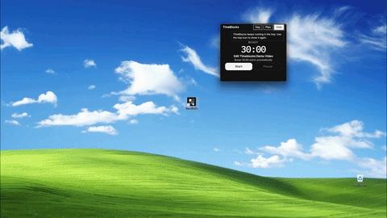

# TimeBlocks

**Own your day. Block by block.**

A small always-on-top Windows widget that turns your day into planned blocks of time. Plan in the morning or a day before, run a focus timer on one block at a time, and see whether the day matched the plan.

**<a href="https://timeblocks-web.vercel.app/">Website</a>** | **<a href="https://apps.microsoft.com/detail/9PFRD4P2ZHWS">Microsoft Store</a>** | **<a href="https://github.com/singlesoup/timeblocks-web/releases/latest/download/TimeBlocks-Setup.exe">Download TimeBlocks-Setup.exe</a>**

Windows 10 &amp; 11 · Free · No account · Data stays on your PC

---

## What is TimeBlocks

  

<em>TimeBlocks answers one question: where did my time actually went?</em>

### Core capabilities:

- **Plan your day in named time blocks** : Deep Work, Emails, Study — each with its own duration
- **One-click focus timer** — 25+5, 30+5, or 60+10 presets; the break starts on its own.
- **Planned vs actual scorecard** — per task, the difference, breaks counted separately.
- **Plan tomorrow tonight** — tomorrow's list is already waiting in the morning.
- **Always-visible widget** — *compact floating timer*, resizable, hides to the tray.
- **Daily reminders** nudge you to plan tomorrow before the day begins
- **Session log** and remarks capture how each day went, not just what you did
- **No account, no cloud, no tracking** — your data never leaves your PC

Free forever. No account, no cloud, no tracking. Everything stays on your PC. Windows 10 & 11.

## How it works

- Plan — name the blocks of your day (Deep Work, Emails) and give each a duration. 
- Focus — run the timer on one block at a time, with automatic Pomodoro-style breaks. 
- Review — the planned-vs-actual report shows what you planned against what you actually did, block by block

The timer writes down what actually happened, right next to what you planned. Focusing *is* the logging — there's no second step.

## Who it's for

Anyone who works alone at a Windows PC — especially ADHD brains, Freelancers, Students.

Distractibility, time blindness, and trouble starting aren't willpower failures. They're neurological patterns that need a different kind of structure: the next task already named, the timer always visible, breaks that start themselves, and immediate feedback at the end of the day. That's what **TimeBlocks** is.

**Not a fit**: teams, managers watching someone else's day, billable hours, or anyone who needs the same plan on a phone.

## How TimeBlocks is different

- A Pomodoro app times a session and forgets the plan. **TimeBlocks** keeps the plan and checks the day against it.
- A todo app tells you whether something is done. TimeBlocks tells you whether it got its time tracked.
- A time tracker explains where the hours went — after the fact, and only if you log them. TimeBlocks writes the actuals while you focus.

## Install

1. Install from the [Microsoft Store](https://apps.microsoft.com/detail/9PFRD4P2ZHWS), or download [**TimeBlocks-Setup.exe**](https://github.com/singlesoup/timeblocks-web/releases/latest/download/TimeBlocks-Setup.exe)
2. Open it. The wizard is titled **Setup - TimeBlocks**. It installs for your Windows user and does not ask you to pick a folder.
3. If Windows says it protected your PC, choose **More info**, then **Run anyway**. The installer is not code-signed yet.
4. Leave **Pin TimeBlocks to the taskbar** checked if you want it one click away, then finish. Setup opens TimeBlocks.
5. Press **Day**. Type a block name, set the planned minutes, and press **Add**.
6. Press **Start**. When focus ends, the break starts on its own. **Hide** keeps it in the tray.

## This repo

Plain HTML and CSS. No build step, no framework: 
- `index.html` — page structure and copy
- `tokens.css` — design tokens (colors, type, spacing)
- `styles.css` — everything else

The design system is strictly monochrome: near-black background, off-white text, hairline borders, square corners. If it isn't black, white, or gray, it doesn't go on the page.

## Support

[soupapps.support@gmail.com](mailto:soupapps.support@gmail.com)
